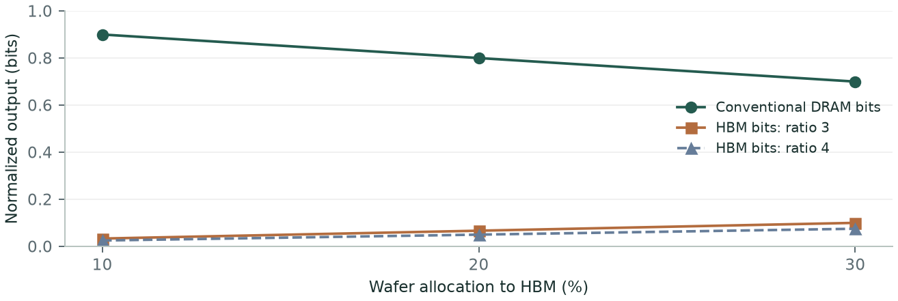
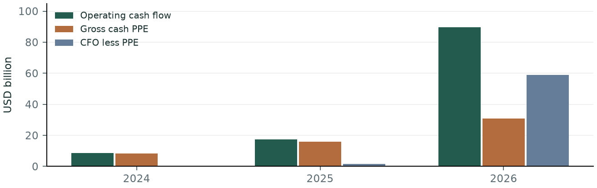
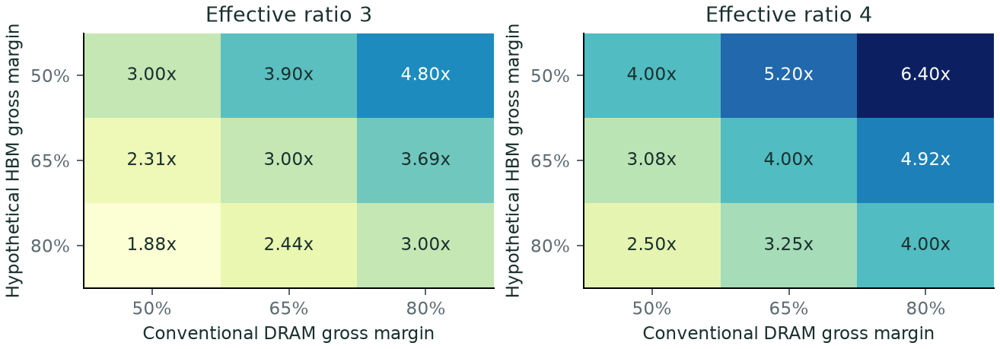
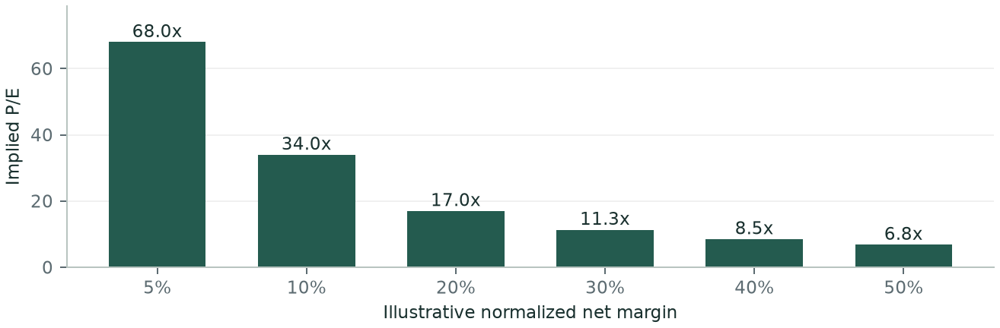
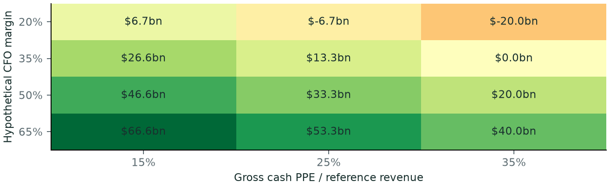

# HBM constraints survive. The equity thesis remains unresolved.

[Download PDF](report.pdf?raw=true)

**An expanded Popper investigation of HBM economics, valuation and the evidence needed for an investment recommendation**

Patterson Research | 14 October 2026 | Economics revision | Agent-prepared review draft

## Executive summary

Cambrian's physical-input mechanism remains credible in HBM. Customer specifications, manufacturing opportunity costs and Micron's disclosed forward HBM pricing support continued investigation. The deeper financial work strengthens the evidence for supplier cash generation, but does not establish standalone HBM economic rents or security-level underpricing. [NV-RUBIN] [MU-Q4] [MU-RELEASE26]

This revision follows the HBM mechanism into the three suppliers' financial statements, reinvestment needs and an explicitly limited issuer valuation reference. The information cutoff remains **13 October 2026, 23:15 New York time**. It also defines future investigations that could support a recommendation, reject an investment expression or leave the evidence unresolved.

The main findings are:

- **HBM exposure is narrower than the issuer.** Micron places HBM for all data-center customers in Cloud Memory, which also contains other products. That segment represents 32.4% of FY2026 sales, an upper bound on data-center HBM revenue share under that classification. Its reported operating margin is below Mobile and Client's. Neither segment margin is a standalone HBM return on capital. [MU-10K-GCS]
- **The economic comparator is the next-best use of scarce capacity.** With an effective three-to-one wafer ratio and equal product gross margins, HBM needs a threefold price-per-bit premium merely to match conventional DRAM contribution per core wafer. This is an accounting illustration, not an estimate of current HBM prices or margins.
- **Group cash generation is substantial and highly regime-sensitive.** Micron's operating cash flow less gross cash PPE purchases rises from $0.121 billion in FY2024 to $58.963 billion in FY2026. That supports the current profit story; the sustainability of this cash scale and rising future investment remain separate questions. [MU-10K-GCS]
- **Reported earnings include other sources of value.** SK hynix's H1 financial income includes material financial-instrument valuation gains; its operating cash flow includes investment dividends. These cannot be attributed to HBM manufacturing. Samsung's consolidated results include businesses beyond memory. [SK-H126] [SS-H126]
- **The valuation denominator matters.** A cached September broker quote and stale, disclosed share-count approximation produce a historical Micron screen around 13.5x then-available trailing sales. This does not contradict the author's forward group median of 3.4x; it shows why a forecast vintage and security-specific expectations bridge are essential. It is not an authenticated current valuation. [MU-QUOTE925-CACHE] [MU-26Q3] [MU-10K25]

**Draft recommendation: none yet.** The report supports researching these businesses, not a particular allocation or a bearish return prediction. A recommendation needs verified security prices and capital claims, normalized product/cash economics, downside and an expectations gap. The future-investigation section states concrete support, refutation and unresolved outcomes for those tests and for extending the mechanism beyond HBM.

All judgments remain review drafts. There is no independent blind skeptic pass, accepted Popper verdict or trading/backtest result. This revision adds financial evidence and calculations while preserving the earlier frozen records.

<!-- pagebreak -->

## 1. The thesis, stated as strongly as the evidence allows

Lonis Hamaili's launch thread argues that AI can erode software moats while physical supply-chain advantages persist. Several public suppliers trade at much lower revenue multiples than software or private AI businesses. Their production depends on accumulated know-how, process complexity and long expansion lead times. AI customers may have enough willingness to pay to displace more price-sensitive buyers. Under this account, supply-chain owners capture a growing share of the value created by AI. [X-THESIS]

The steelman is conditional: **if AI demand remains strong, qualified supply expands slowly, buyers cannot cheaply substitute, suppliers retain bargaining power, and starting prices understate sustainable cash earnings, selected supply-chain equities can offer attractive returns.** This avoids assuming that every bottleneck, incumbent or low-multiple stock qualifies.

The argument is a chain:

**AI workloads -> hardware requirements -> qualified supply constraint -> negotiated prices -> incremental economic profit -> equity value relative to price.**

Each arrow can fail while the preceding observation stays true. A technically essential product can have competitive margins. A highly profitable business can be an expensive stock. An expanding market can reward customers more than suppliers.

HBM is the selected deep case because customer specifications, three supplier disclosures, original memory-efficiency research and historical filings make several links observable. This is a bounded evidence-availability choice, not a claim that HBM is the best investment or that every other layer was exhaustively ranked. The broader thread is covered in Section 12; lithography, wafers, MLCCs, electrical equipment and all individual securities do not receive equivalent company-level investigations.

**Attribution rule.** C3, the invariant AI-to-HBM proportionality claim, and C4, the aggregate-DRAM-to-HBM growth-cap claim, are analyst-added bridge tests. They expose assumptions that a simplistic HBM implementation could require. Rejecting them does not show that Hamaili explicitly asserted either strong form.

**What counts as a kill?** A counterexample can refute a universal implication. A missing disclosure cannot prove a claim false. An alternative mechanism can undercut causal identification without proving that the claimed effect has the opposite sign. These distinctions govern the judgments throughout the report.

<!-- pagebreak -->

## 2. First principles: bits, bandwidth and qualified output

HBM is not merely conventional DRAM stacked a prescribed number of times. Its economic role includes high bandwidth, proximity to the accelerator, power constraints, interconnects and packaging. The relevant unit depends on the claim: saleable bits for supply accounting, bandwidth for some workload limits, qualified stacks for procurement and cash profit for investment analysis.

NVIDIA specifies HBM4 for Rubin, including 288 GB capacity and up to 22 TB/s bandwidth. This establishes a selected product's design dependence. It does not establish how many Rubin systems will be bought, the HBM supplier mix, purchasing terms or the memory architecture of every AI workload. [NV-RUBIN]

Micron's June 2024 prepared remarks state that HBM3E requires approximately three times the wafer supply needed for equal DDR5 bits at the same technology node. Its March 2025 deck expects the ratio to rise for later generations and exceed four to one for HBM4E. These are dated management statements. The report does not convert them into measured 2026 HBM4 industry yields. [MU-24REMARKS-GCS] [MU-25DECK-GCS]

A useful production model has separate constraints:

**Saleable output = minimum of core-die availability, base-die availability, assembly/test throughput and customer-qualified output, expressed in compatible units.**

For core-die capacity, output depends on wafer starts, die size, node, usable dies, process yield and allocation. For assembly, known-good-die screening, bonding, thermal performance, stack configuration and test losses matter. For qualification, meeting a supplier specification does not necessarily complete a customer's platform approval.

Stacking does not justify estimating factory yield as die yield raised to the number of layers. Known-good-die selection changes the input population; assembly and final-test yields remain separate. The illustration in this report uses an effective equal-bit wafer ratio. Applying an extra yield penalty to that same ratio would double-count losses if the ratio already incorporates them.

**Surviving claim:** manufacturing creates a real opportunity cost. **Unresolved measurement:** comparable current qualified HBM bits by generation, supplier and delivery period. A long lead time is evidence about adjustment speed, not proof of permanent scarcity.

SK hynix's filing independently describes manufacturing complexity and ramp-yield risk. That corroborates the qualitative barrier, but it does not independently measure Micron's numerical trade ratio. [SK-PROSPECTUS-FA]

<!-- pagebreak -->

## 3. A denominator error: aggregate DRAM is not HBM

The author's supply chart forecasts roughly 2.3-fold DRAM output growth from 2026 to 2030, alongside separate NAND, MLCC and leading-edge wafer forecasts. HBM is not a separate series in that chart. Its forecast therefore cannot settle HBM output growth without an allocation model. [X-THESIS]

Let W be normalized wafer capacity, b conventional DRAM bits per wafer, f the share allocated to HBM, and r the effective equal-bit wafer trade ratio. Then:

**HBM bits = W x f x b / r.**

**Conventional DRAM bits = W x (1 - f) x b.**

**Total DRAM bits = W x b x [(1 - f) + f/r].**

Hold W and b constant. Moving f from 10% to 20% doubles HBM bits. Conventional bits decline from 0.90 to 0.80. At r = 3, total bits decline from 0.933 to 0.867. HBM can thus grow rapidly inside an aggregate market whose bit output is barely growing or shrinking.

| HBM wafer allocation | HBM bits, r=3 | Conventional bits | Total bits, r=3 | HBM bits, r=4 |
| --- | --- | --- | --- | --- |
| 10% | 0.033 | 0.900 | 0.933 | 0.025 |
| 20% | 0.067 | 0.800 | 0.867 | 0.050 |
| 30% | 0.100 | 0.700 | 0.800 | 0.075 |

**Illustration only.** Allocations are predefined scenarios, not estimates of today's factories. The ratio cases draw on dated supplier statements; b and W are normalized accounting units. No global capacity forecast is fitted.

The bullish implication also survives: an HBM ramp can squeeze conventional DRAM supply and lift that product's economics. Micron explicitly describes the tradeoff. The investment exposure can therefore operate through displaced conventional output as well as HBM sales. That is a richer thesis than treating all memory products as one bottleneck. [MU-24REMARKS-GCS]

**Draft C4 judgment:** the analyst-added equal-growth-cap implication is falsified by allocation accounting. This does not falsify the author's aggregate supply forecast, and it does not show that qualified HBM supply will exceed demand.

<!-- pagebreak -->

## 4. Memory efficiency is a real countermechanism

The strongest kill attempt against a fixed demand coefficient is not a forecast of weak AI adoption. It is evidence that the same broad activity can use a different memory architecture.

| Countermechanism | Primary observation | What it challenges | What it does not establish |
| --- | --- | --- | --- |
| MLA | DeepSeek caches a compressed latent representation rather than all attention-head KV vectors. [DS-V3] | Fixed KV bytes per token | Equal model quality or lower total-market HBM purchases |
| Lower precision | DeepSeek describes FP8 storage/training and memory-saving design. [DS-HARDWARE] | Fixed bytes per model state | Whole-system memory reduction equal to a bit-width ratio |
| KV quantization | Google reports at least sixfold KV-cache compression in specified tests. [GOOGLE-TQ] | Invariant cache footprint | Sixfold reduction in weights, all GPU memory or industry demand |
| Context tiering | NVIDIA adds an Ethernet-attached flash tier and prestages context into host/GPU memory. [NV-CMX] | All useful context must remain in HBM | Removal of hot, latency-critical HBM |

DeepSeek's hardware paper compares 70 KB/token for its KV cache with 327 and 516 KB/token in other named models. These are different model designs, not a matched-quality causal experiment. The relevant evidence is the existence of adjustable memory intensity; no industry forecast is inferred from those ratios. [DS-HARDWARE]

A schematic demand identity is **HBM requirement = activity x memory intensity x HBM-resident share**, adjusted for concurrency, utilization and latency requirements. Tokens generated are a flow; installed memory is a stock that supports simultaneous work. The identity is a research decomposition, not a calibrated forecasting equation.

Suppose memory intensity halves. Total requirement falls only if activity and residency do not offset the reduction. Doubling activity exactly offsets it in this simplified identity. More context, concurrency or useful work can increase memory demand despite greater efficiency. This rebound possibility protects the steelman from the equally simplistic inference that compression must cause an HBM collapse.

**Draft C3 judgment:** reject invariant proportionality. Continue testing actual adoption, workload mix, concurrency and purchased configurations. The evidence supports an adjustable coefficient, not the sign of total future demand.

The bounded correction search found no official removal of HBM4 from the selected Rubin specification. Reports about other accelerators or potential configurations do not change that conclusion without a customer-level correction.

<!-- pagebreak -->

## 5. Supply response: a timeline with different milestones

A physical barrier slows adjustment. It does not freeze supply. Existing suppliers can improve yields, redirect wafers, introduce packaging changes or expand plants. Each route has a different delay and qualification burden.

| Supplier / route | Disclosed milestone | Research interpretation |
| --- | --- | --- |
| Samsung HBM4 | Commercial shipments and mass production announced February 2026; capacity expansion planned. [SS-HBM4] | Active incumbent response. No disclosed all-customer qualified-volume denominator. |
| SK hynix M15X | Wafer input began Q1 2026; gradual ramp planned. [SK-PROSPECTUS-FA] | A ramping fab, not just a distant announcement. Saleable HBM share remains unspecified. |
| SK hynix Yongin | Phase 1 cleanroom expected Q1 2027. [SK-PROSPECTUS-FA] | Cleanroom opening precedes useful output, qualification and volume ramp. |
| SK hynix packaging | P&T7 construction completion expected end-2027; Indiana operations H2 2028. [SK-PROSPECTUS-FA] | Separate assembly route and horizon. Construction is not qualified output. |
| Micron Singapore | New HBM packaging output expected early 2027. [MU-Q4] | Packaging capacity addition; not a new DRAM wafer fab. |
| Micron Idaho / Tongluo | ID1 wafer output and Tongluo shipments expected mid-2027. [MU-Q4] | Initial output and shipments are different milestones; volumes are not reconstructed. |
| Micron Japan / ID2 | Initial output expected late-2028. [MU-Q4] | Long lead-time response beyond the nearest contract year. |
| JEDEC SPHBM4 | July 2026 release retains HBM4 core dies with an alternative interface/base die for organic substrates. [JEDEC-SP] | Packaging alternative. Standard publication does not establish deployment or relief of core-die scarcity. |

The JEDEC announcement describes 512 data signals and 4:1 serialization, compared with HBM4's 2,048 signals, targeting comparable aggregate throughput. It does not establish a current qualified replacement for the Rubin configuration. [JEDEC-SP]

SK hynix's iHBM thermal solution and HBM4E samples show continuing process innovation. Their reported performance is supplier testimony; samples and intended future use do not prove current industry yield or surplus. [SK-IHBM] [SK-HBM4E]

**Draft C7 judgment:** mixed. Know-how and qualification barriers survive. A premise of no competitive response does not. Whether response erodes rents depends on demand, saleable output, cost and contract timing, none of which an announcement alone settles.

<!-- pagebreak -->

## 6. Supplier comparison: commercial evidence and its limits

| Question | Micron | SK hynix | Samsung |
| --- | --- | --- | --- |
| Product evidence | HBM roadmap and contracted supply disclosures | HBM4 shipment/ramp and HBM4E samples | HBM4 commercial shipment and sales ramp |
| Tightness evidence | Most 2027 HBM bits covered by agreements | Demand exceeds capacity in broader memory discussion | Continuing broader memory constraints expected |
| Pricing evidence | Explicit year-on-year increase in forward HBM agreements | Reported broader price increases; historical DRAM ASP table | Broader memory profitability and demand discussion |
| Contract evidence | Take-or-pay, fixed/renegotiated prices and bands in SCAs | LTAs with around ten customers | Public release does not provide comparable detailed contract terms |
| Expansion | Packaging and new fab milestones | M15X, Yongin, packaging investments | HBM4 capacity expansion and next-generation samples |
| Missing comparator | Standalone HBM cash profit versus displaced product | Same HBM economic-profit measure | Same HBM economic-profit measure |

Sources: [MU-Q4], [MU-10K-GCS], [SK-Q2], [SK-PROSPECTUS-FA], [SS-Q2], [SS-HBM4]. Broad-memory statements remain broad; the table does not relabel them as HBM-only observations.

The strongest narrow commercial evidence is Micron's disclosed forward HBM price direction. Contracted supply supports visibility for that supplier's planned output. It does not establish the volume of unsatisfied orders, the cancellation rights of every contract, competitors' available inventory or the balance of the whole qualified HBM market.

Two suppliers reporting tightness is useful corroboration, but their shared exposure to the same buildout creates correlated incentives and observations. They are distinct issuers, not independent experiments. Corporate disclosure, original customer documents and standards provide different evidence types; repeating one release through several websites does not increase its independence.

The sources do not reconcile **qualified supply and demand by generation and delivery quarter**. HBM3E, HBM4 and later products have different qualification, bandwidth, power and price conditions. A sold-out planned supply schedule can coexist with increased future output, a different generation's surplus or customers changing configurations.

**Draft C5 judgment:** the pricing subclaim is corroborated at the disclosure level. The composite marketwide scarcity predicate remains mixed. No captured primary source demonstrates enough same-horizon qualified surplus or cancellation to kill near-term tightness. This is a bounded search result, not proof that counterevidence does not exist.

<!-- pagebreak -->

## 7. Price chronology: the causal story needs a window

The thread links delayed memory price increases to price-sensitive incumbent buyers. That is plausible as one mechanism. A causal conclusion requires a specified product, price measure, event window, inventory cycle and counterfactual. The pooled buyer-share graphic supplies none of those by itself. [X-THESIS]

| Observation | Period / comparator | Implication and limit |
| --- | --- | --- |
| Micron DRAM ASP: high-teens increase; NAND: low-30% increase | FQ2 2024 versus FQ1 2024 | Prices rose well before Q4 2025. Issuer ASP includes product/customer mix. [MU-24Q2-GCS] |
| SK hynix DRAM ASP rises in Q2-Q4 2023; over 20% in Q1 2024 | Calendar quarters, sequential USD ASP | Independent supplier chronology also rejects a literal first-rise reading. [SK-PROSPECTUS-FA] |
| SK hynix DRAM ASP flat in Q1 2025; smaller rises Q2/Q3; mid-20% rise Q4 | Sequential calendar-quarter ASP | Consistent with a distinct late-2025 acceleration, without identifying its cause. [SK-PROSPECTUS-FA] |
| Micron DRAM margins improve with HBM mix and lower costs while NAND/mobile ASP weaken | FQ3 2025 versus FQ2 | Product cycles diverge; margin changes cannot be attributed solely to HBM prices. [MU-25Q3-GCS] |

Micron's FQ2 2024 gross margin was 19%, compared with negative 1% in the prior quarter and negative 33% a year earlier. Inventory write-downs and sale of previously written-down stock affected the comparison. The historical swing is evidence of accounting and capital-cycle sensitivity, not a direct estimate of today's normalized margin. [MU-24Q2-GCS]

The charitable interpretation is that the author refers to the latest sharp acceleration, not the first recovery in any cycle. The report retains that interpretation. Earlier ASP increases do not refute a claim about a properly defined late-2025 event.

Several explanations can coexist: buyer substitution, inventory normalization, earlier production discipline, shifting wafer allocation, node transitions, contract resets and a higher-value product mix. Public issuer comparisons do not identify their separate contributions. A pooled price-sensitive share is not an elasticity estimate and cannot establish how a particular customer responds to a higher contract price.

**Draft C6 judgment:** mixed. Reject the broad literal chronology; leave the narrower causal account unresolved. A valid next test would fix a memory product, a dated price series and competing supply/inventory explanations before comparing the sequence.

<!-- pagebreak -->

## 8. Contracts change both the upside and the downside

Micron's FY2026 filing describes SCAs with enforceable volumes and take-or-pay structures. Most have minimum and maximum price bands; other pricing is fixed or periodically negotiated. Customer deposits may be retained after unmet purchase commitments but are returned when the customer performs. $12.75 billion of deposits received in FY2026 are mostly scheduled for repayment in 2029-2031. Letters of credit are contingent security, not automatically recognized sales. These terms concern broad SCAs, not an identified HBM-only contract pool. [MU-10K-GCS]

The bullish reading is substantial. Volume commitments can reduce utilization risk, deposits can secure future purchases, and price floors may protect profitability during a downturn. These arrangements are stronger evidence than a headline about AI enthusiasm.

The counterargument is equally concrete. A price ceiling can limit upside participation when spot scarcity intensifies. A fixed agreement can transfer part of future gains to customers. Supplier delivery obligations create performance risk. A floor that protects a gross margin does not independently guarantee a positive return on the capital invested to supply the contract.

A deposited dollar cannot be counted as both earned revenue and free equity cash. Deposits improve liquidity while carrying an associated liability and potential repayment. The analysis must follow the filing's classification. In particular, these customer contract-liability deposits are shown within financing cash flows; the report does **not** subtract them from operating cash flow as if the issuer had placed them there. [MU-10K-GCS]

| Contract feature | Bullish channel | Refutation route |
| --- | --- | --- |
| Volume commitment | Better utilization visibility | Customer credit, contractual exceptions and delivery obligations |
| Price floor | Lower downside price risk | Floor economics may not cover full opportunity cost and reinvestment |
| Price ceiling | Visibility may support long commitments | Supplier may surrender uncapped scarcity upside |
| Refundable deposit | Security and near-term liquidity | Repayment obligation; not earned distributable cash |
| Custom product | Design-in and switching costs | Bespoke capital and customer/platform concentration |

Micron estimates its 26 SCAs cover over 35% of revenue through 2030, with three-quarters of that estimated SCA revenue having a defined pricing framework. At a hypothetical 35% share, 75% x 35% = 26.25% of company revenue, not 75%. Actual coverage is greater than the illustrative 35% input, and defined pricing is not identical to price-band coverage or HBM coverage. The filing's remaining performance obligations use minimum-price commitments and explicitly are not intended as future-revenue forecasts. [MU-Q4] [MU-10K-GCS]

Contract structure cannot be generalized across the three suppliers from one filing. The captured SK hynix release establishes LTAs; it does not establish that their HBM contracts have no price ceilings. The report declines to adopt that claim from forum commentary. Samsung's captured releases do not supply matching detailed terms.

The research question changes from “can customers pay more?” to “what cash flows do these specific agreements permit suppliers to retain, at what capital requirement and risk?”

<!-- pagebreak -->

## 9. From gross margin to economic rent

Scarcity rent means more than a profitable sale. For HBM, the relevant comparison is the incremental cash earnings obtained from scarce manufacturing resources relative to their next-best use, after the investment needed to maintain and expand the product.

A disciplined bridge has five parts:

1. **Revenue:** qualified saleable volume x realized net price, with the generation, contract and currency defined.
2. **Operating cost:** wafer use, known-good-die input, assembly/test, customer-specific costs, R&D and ramp losses.
3. **Opportunity cost:** conventional DRAM or another product displaced by the same constrained resources.
4. **Reinvestment:** maintenance and expansion capex, working capital, incentives, taxes and future deposit repayments.
5. **Risk and valuation:** customer/platform concentration, capacity-cycle downside, claims on the business and starting security price.

Micron describes a narrowing gross-margin gap between HBM and conventional DRAM in its forward pricing discussion. That makes the comparator material. A margin percentage alone still does not determine contribution dollars per wafer or return on capital; prices, effective bit output and incremental capital differ. [MU-Q4]

SK hynix's prospectus warns that per-bit prices can decline faster than manufacturing costs. It reports substantial ongoing capital investment and an active expansion program. Those are concrete mechanisms for capital-cycle reversal, although a risk factor is not evidence that the downside has already occurred. [SK-PROSPECTUS-FA]

There is also affirmative economic evidence. Micron attributes part of its 2025 DRAM margin improvement to HBM mix and cost reductions. It supports a historical contribution to accounting profits. It does not disclose a matched standalone HBM economic-profit series for all suppliers. [MU-25Q3-GCS]

**A useful stress matrix** varies demand intensity, qualified output, realized prices, displaced-product margins and required reinvestment together. A price decline combined with newly qualified supply can be worse than either shock separately. A price floor and disciplined capacity schedule can mitigate the combination. The report describes these mechanisms without inventing probabilities or filling missing product margins with consolidated values.

**Draft C8 judgment:** insufficient data for durable shareholder scarcity rents. The limitation follows from product-level economic identification, not from stopping evidence collection at the first approval gate. The inspected evidence supplies both a serious bull case and specific ways the cash-flow inference can fail.

<!-- pagebreak -->

## 9A. Micron: quantify exposure before assigning HBM profits

Micron's segment boundary provides a useful constraint. Cloud Memory includes HBM for all data-center customers, but also other memory sold to hyperscale customers. The FY2026 segment data are as follows. [MU-10K-GCS]

| Reported segment | Revenue, $bn | Operating profit, $bn | Operating margin |
| --- | --- | --- | --- |
| Cloud Memory | 43.085 | 31.225 | 72.5% |
| Core Data Center | 37.592 | 29.539 | 78.6% |
| Mobile and Client | 36.601 | 29.208 | 79.8% |
| Automotive and Embedded | 15.886 | 11.217 | 70.6% |

Margins above are calculated from the reported segment values. They are not standalone HBM margins. The segment note separately reconciles unallocated expenses, chiefly stock-based compensation and other specified items; summing segment operating profits does not directly produce consolidated GAAP operating income. [MU-10K-GCS]

Because HBM for all data-center customers is classified inside Cloud Memory, its 43.085/133.188 = **32.35% share of group revenue bounds data-center HBM revenue share**, not an estimate of it. It does not bound HBM's profit share without assumptions about the other products' profits and allocated costs. A smaller revenue share can still have a large marginal effect on earnings or capacity allocation.

The Mobile and Client comparison is an actual counterexample to assuming that an AI-associated segment must have the highest reported margin. It does not establish which product has the highest cash contribution per wafer. The segments mix products, customers and costs. Broad DRAM scarcity can reward conventional products as HBM absorbs capacity.

Micron also reports no customer accounting for 10% or more of total FY2026 revenue. That is a whole-company concentration disclosure. It does not identify customer concentration within the smaller HBM book or shared exposure to one accelerator platform. [MU-10K-GCS]

**What this resolves:** the report can now bound revenue exposure and compare actual segment outcomes. **What it leaves unresolved:** HBM realized price/bit, saleable output, allocated capital and profit after the next-best product's contribution. Using Cloud Memory margin as HBM margin would conceal the uncertainty rather than solve it.

For a security-level model, the financial bridge should cover the entire company. HBM, other DRAM and NAND can reinforce one another through shared capacity, or move in different directions through their separate demand and technology cycles. Valuing only the HBM story leaves material exposures unmodeled.

<!-- pagebreak -->

## 9B. Cash conversion: a large gain that must survive reinvestment

The following reconstruction uses consolidated operating cash flow minus **gross cash PPE purchases**. Capital incentives are shown separately. It is a transparent cash residual, not a complete estimate of cash distributable to common shareholders or the issuer's precise non-GAAP free-cash-flow definition. [MU-10K-GCS]

| Micron fiscal year | CFO, $bn | Gross cash PPE, $bn | CFO less PPE, $bn | Plus capital incentives, $bn |
| --- | --- | --- | --- | --- |
| 2024 | 8.507 | 8.386 | 0.121 | 0.436 |
| 2025 | 17.525 | 15.857 | 1.668 | 3.673 |
| 2026 | 89.675 | 30.712 | 58.963 | 62.279 |

The CFO-minus-PPE margin rises from 0.5% to 4.5% to 44.3% of annual revenue. This is strong evidence for the current group's cash-generating capacity. It is not evidence that 44.3% is a sustainable HBM cash margin. Fiscal 2026 contains 53 weeks versus 52 in fiscal 2025; the periods are reported as supplied, not normalized into a growth forecast.

Normalization must reconcile customer receivables, inventories, supplier payables, tax timing and other accrued liabilities. Stock-based compensation is added back in CFO but still has an economic cost through dilution or repurchases. Acquisitions, capitalized intangible purchases, debt policy and deposit repayments can also alter distributable cash. Government assistance can reduce shareholder-funded investment, but its conditions and continuing availability require separate treatment.

The FY2026 filing gives FY2027 net-capex guidance of about $25 billion in the first half and more in the second half. Taken literally, that implies **more than $50 billion for the year**, a forward statement with market and timing caveats. Net capex after incentives differs from the gross-PPE measure above. [MU-10K-GCS]

A declared stress holds FY2026 revenue at $133.188 billion and assumes a 35% CFO margin. CFO would be $46.616 billion. The announced net-capex lower bound would exceed that cash flow by more than $3.384 billion. This is a conditional stress, not a forecast: higher revenue or cash margin could change the result. It exposes why current profit and future reinvestment belong in the same investment model.

<!-- pagebreak -->

## 9C. SK hynix and Samsung: cash is real, attribution is harder

The Korean supplier comparison uses H1 2026 consolidated statements, in **KRW trillions**. It keeps six-month periods distinct from Micron's fiscal year and makes no FX-based ranking. [SK-H126] [SS-H126]

| H1 2026 consolidated measure | SK hynix | Samsung |
| --- | --- | --- |
| Revenue | 131.895 | 305.373 |
| Operating cash flow | 91.743 | 145.355 |
| Gross cash PPE purchases | 18.329 | 31.235 |
| CFO less gross PPE | 73.414 | 114.120 |
| Residual after cash intangible purchases | 72.748 | 112.395 |

These are group accounting residuals. They omit other investment purchases, acquisitions and capital-structure changes; they are not comparable standalone HBM free cash flows. Samsung's quarterly presentation independently anchors its operating-cash-flow progression: Q1 plus Q2 reconciles approximately to the half-year total. These are two documents from one issuer, not independent economic replications. [SS-Q226]

SK hynix's H1 finance income is KRW 82.915 trillion, including KRW 63.179 trillion of financial-instrument valuation gains. Its CFO also includes KRW 13.984 trillion of dividends received, about 15.2% of CFO. Excluding only those cash dividends reduces CFO-minus-PPE from KRW 73.414 trillion to KRW 59.430 trillion. This narrow adjustment isolates one disclosed cash item; it is not a fully normalized semiconductor cash-flow estimate. Do not subtract a noncash valuation gain again from a cash-flow statement that already reconciles it. [SK-H126]

This matters for earnings multiples. Financial assets and their cash distributions can be valuable to shareholders, but valuation gains are not proof of HBM pricing power. A manufacturing model should normalize the operating business and value material financial holdings separately, with tax and ownership effects. Otherwise it can count the same holding in both earnings and excess-asset value.

Samsung's DS segment includes memory and other semiconductor activities, while consolidated financials include additional businesses. Intra-group memory costs can benefit the component supplier while pressuring device margins. A sum-of-parts model needs consistent internal-transfer and corporate-cost treatment. The company's October 8 Q3 guidance, available before the cutoff, shows continued group strength but supplies no HBM-only cash-flow series; guidance is not a realized quarter. [SS-GUIDANCE3]

**Finding:** the cash-generation evidence is stronger than the initial qualitative review. The measured object remains the issuer/group, and accounting classifications differ. That strengthens the case for an issuer model while preventing direct transfer of the reported margins into HBM economics.

<!-- pagebreak -->

## 9D. Unit economics: the price premium must pay for scarce capacity

Normalize conventional DRAM saleable bits per core wafer and its price per bit to one. Let r be the effective equal-bit wafer ratio, a the HBM price-per-bit premium, gH HBM gross margin, and gD conventional DRAM gross margin. Then:

**HBM contribution per core wafer = a x gH / r.**

**Conventional contribution per core wafer = gD.**

HBM matches the comparator when **a = r x gD / gH**. This is an accounting identity for declared effective outputs, not a claim that pricing or costs currently equal the scenario inputs.

| Effective wafer ratio | HBM margin | Conventional margin | Break-even HBM price/bit premium |
| --- | --- | --- | --- |
| 3 | 50% | 80% | 4.80x |
| 3 | 65% | 65% | 3.00x |
| 3 | 80% | 50% | 1.88x |
| 4 | 50% | 80% | 6.40x |
| 4 | 65% | 65% | 4.00x |
| 4 | 80% | 50% | 2.50x |

The full grid preserves 90 cases with HBM price premiums from 2x through 6x. None is an issuer estimate. Current HBM4 effective wafer use and standalone product margins remain unmeasured here.

Higher revenue per bit can still produce less contribution per core wafer. Gross contribution also omits the full cost of incremental capital. If assembly or qualification is binding, compare contribution per unit of that constraint too.

Effective output and gross margin already reflect the selected loss/cost definitions; do not add yield or packaging costs twice. The empirical upgrade requires matched product premiums, saleable output, attributable cost and capital, not a group margin or TAM estimate.

<!-- pagebreak -->

## 10. What a low revenue multiple can and cannot say

The author's valuation graphic uses public **market capitalization divided by next-twelve-month consensus revenue**, dated 25 September 2026. It shows a seven-company memory median of 3.4x and SK hynix at 2.8x. Private AI comparisons use last-round valuations and revenue run rates, with different dates and bases. The graphic is a source assertion; its full constituents and consensus vintage were not independently reconstructed. [X-THESIS]

A revenue multiple measures a price relative to sales, not a price relative to retained cash. At the same equity numerator, period and share basis:

**P/E = (P/S) / normalized net margin.**

| Illustrative normalized net margin | Implied P/E at P/S = 3.4 |
| --- | --- |
| 5% | 68.0x |
| 10% | 34.0x |
| 20% | 17.0x |
| 30% | 11.3x |
| 40% | 8.5x |
| 50% | 6.8x |

**Algebraic illustration only.** These margins are predefined scenarios, not estimates for Micron, SK hynix or Samsung. The 3.4x input is the author's group median. The calculation does not assign that median to a particular issuer, estimate fair value or produce a target price.

Market capitalization and enterprise value cannot be interchanged. Public consensus forecasts and private revenue run rates cannot be treated as matched measures. Whole-company sales include non-HBM products, and Samsung includes substantial non-memory businesses. A group's median P/S divided by a group's median margin is not the median of individual P/Es.

A valid underpricing test would reconcile exact share classes, currencies, debt, cash, liabilities, dilution and segment exposures, then compare a normalized cash-flow model with the expectations embedded in the same-cutoff security price. At least base and downside paths would need explicit prices, volumes, costs and reinvestment.

**Draft C9 judgment:** the screen identifies research candidates; it does not prove underpricing. A historical issuer reference and conditional inversion follow. Current price/claims and the original forward-consensus package remain unverified.

<!-- pagebreak -->

## 10A. An issuer reference: Micron's historical price versus trailing results

The deeper search recovered a **cached broker header** quoting MU at $1,082.28 as of the September 25 close. The direct live page instead showed October 14 intraday data and was excluded from the cutoff packet. The archive's adjusted IEX minute observation is $1,081.87 at 15:59 on September 25; its adjustment and market basis differ. The report does not assert which discrepancy component explains the $0.41 difference. [MU-QUOTE925-CACHE]

Use the Q3 filing's June 17 outstanding common shares, 1,129,393,151, as an explicit stale-share approximation. This produces an equity reference of about $1,222.32 billion, **not certified September 25 market capitalization**. The share count is outstanding common shares, not the diluted weighted-average EPS denominator. [MU-26Q3]

Then-available trailing financials through May 28 are reconstructed as original FY2025 annual plus FY2026 nine months minus FY2025 nine months. The original annual filing supplies the older-year vintage; later FY2026 annual results are excluded from this reference screen. [MU-10K25] [MU-26Q3]

| Historical reference calculation | Result |
| --- | --- |
| TTM revenue | $90.274bn |
| TTM GAAP net income | $50.469bn |
| TTM operating cash flow | $51.432bn |
| TTM gross cash PPE purchases | $25.260bn |
| Approximate equity / TTM revenue | 13.54x |
| Approximate equity / TTM GAAP net income | 24.22x |
| CFO-minus-PPE / approximate equity | 2.14% |
| Residual including capital incentives / approximate equity | 2.44% |

The author's 3.4x figure is a **forward-revenue group median**. The 13.54x figure above is a **trailing-revenue individual-issuer reference** with imperfect price/share authentication. Comparing them as interchangeable valuations would be a new denominator error. They can differ substantially without either original arithmetic being wrong.

At the approximate equity reference, revenue of $359.51 billion would produce P/S = 3.4. This is an inversion, not an estimate of Micron consensus revenue or proof of the author's intended issuer multiple. The complete chart constituents, issuer forward denominator and contemporaneous forecast distribution remain unverified.

**Finding:** a real issuer reference now exposes the scale of the normalization problem. It does not establish current cheapness, overvaluation or expected return. No October 13 close, exact same-date capitalization or full current equity cash-flow model is certified.

<!-- pagebreak -->

## 10B. Conditional valuation: identify what the price would require

A stationary equity cash-flow model gives **P = next-year distributable equity cash / (cost of equity - growth)**. At a consistent next-year revenue denominator, required cash margin equals **P/S x (cost of equity - growth)**. The cash must be after reinvestment, taxes and financing needs. CFO, EBIT and gross margin are not substitutes for it.

| Cost of equity | Growth 0% | Growth 2% | Growth 4% |
| --- | --- | --- | --- |
| 8% | 27.2% | 20.4% | 13.6% |
| 10% | 34.0% | 27.2% | 20.4% |
| 12% | 40.8% | 34.0% | 27.2% |

This table uses the author's hypothetical P/S = 3.4. The grid is declared before calculation; neither the discount rate nor terminal growth is an adopted investment hurdle or forecast. An infinite-horizon model requires cost of equity above growth and a sustainable financing/reinvestment path.

For the next illustration only, treat then-available TTM revenue as a hypothetical next-year reference scale; growth applies to cash payouts after that first year. This is not a revenue forecast. Applying the stationary inversion at the historical Micron **trailing** reference ratio of 13.54, cost of equity 10% and growth 2% gives a 108.3% cash-margin requirement against that frozen revenue scale. That is not a plausible claim about a normal manufacturing cash margin. It shows that a flat-scale stationary model cannot explain the reference price with ordinary margins. A transition to much larger revenue, other asset value or different assumptions would be necessary. This is a deliberately restrictive model, not evidence that the actual stock is overpriced.

At a hypothetical sustainable 30% distributable cash margin with the same cost/growth assumptions, the reference equity value would require about **$325.95 billion of next-year revenue** in the stationary model. It is not a consensus estimate, target price or inferred probability. Excess cash, debt, liabilities and finite high-growth transitions need their own reconciliation before an issuer equity valuation can use that result.

A separate company cash stress holds FY2026 revenue fixed and varies CFO margin and gross-PPE ratio. All 12 cells are preserved. Negative values expose funding dependence; positive values are still not fully distributable equity cash.

**Finding:** underpricing cannot be established by a low multiple without specifying the future cash denominator and its durability. This revision quantifies the dependency and the investment scale; it does not manufacture a fair value from unavailable inputs.

<!-- pagebreak -->

## 11. The demand-to-value chain after refutation

| Link | Evidence that survives | How the link can fail |
| --- | --- | --- |
| AI -> memory demand | Selected customer specifications; expanding technical requirements | Efficiency, workload mix, utilization and context residency change |
| Demand -> constrained qualified supply | Supplier planning testimony; manufacturing opportunity cost | Reallocation, yield, capacity, packaging and qualification improve |
| Constraint -> higher prices | Micron's disclosed forward HBM price increase | Customer bargaining, contract ceilings or product substitution |
| Prices -> economic profit | Historical margin contribution and forward commercial terms | More silicon/capital, displaced-product profits and ramp costs |
| Economic profit -> equity outperformance | No matched security-level demonstration in this study | Starting expectations already high; debt, dilution, risk and cyclicality |

The first two links deserve continued investigation. They identify a plausible economic mechanism. The last two require a financial model and actual contract/segment inputs. They cannot be filled by carrying technical confidence down the chain.

The thesis also has two different clocks. A qualification or capacity constraint can be binding over the next few quarters while an expansion response matters over several years. A contract can lock a near-term commercial gain while a high purchase price discounts years of exceptional profitability. “Scarce now,” “durably profitable” and “cheap today” are separate predicates.

The evidence does not justify a symmetry error. Failure to prove a bullish investment thesis is not proof of a bearish thesis. Architecture improvements may reduce memory per task but increase total task demand. Supply additions may relieve shortage but reduce unit costs. Contracts may cap upside while protecting downside. Net effects require matched assumptions.

**The strongest surviving version** is narrower and testable: selected HBM suppliers have near-term exposure to a qualified-product constraint and disclosed contracting activity; excess shareholder returns depend on how much of that advantage survives competition, reinvestment and existing market expectations.

This version avoids treating advanced manufacturing as a permanent moat or AI growth as a mechanically fixed bill of materials. It also preserves the original insight that the physical economy can become strategically important even as software supply grows rapidly.

<!-- pagebreak -->

## 12. Coverage of the wider Cambrian thread

| Wider proposition | Assessment in this report | Remaining test |
| --- | --- | --- |
| Physical suppliers are cheaper than software/private AI | Chart metric and date recovered; comparison has heterogeneous denominators | Reconstruct constituents, forecast vintages and normalized cash-flow comparators |
| AI beta plus buyer willingness to pay matters | Coherent mechanism; pooled sensitivity shares do not identify elasticity | Product-level substitutions, contract resets and observed price/volume response |
| Accumulated know-how caps supply response | HBM barriers survive; incumbent expansions and packaging alternatives qualify permanence | Comparable qualified output and cost paths; separate other supply-chain layers |
| AI-exposed portfolios outperform skeptical portfolios | No specified basket, benchmark or holding period | Freeze investable weights, horizon, costs and scenario probabilities before return evaluation |
| Infrastructure equity dominates lab equity | Scenario checkmarks describe conditional operations, not priced securities | Compare entry valuations, security rights, dilution, downside and payoff distributions |
| European investors capture too little AI value | Author chart inspected, not independently reconstructed | Define investor residency, beneficial ownership, universe, currency and GDP comparator |
| Large losses for conventional portfolios in AGI scenarios | Conditional scenario arithmetic, not an empirical loss forecast | Explicit rate paths, durations, credit/default models, horizons and probabilities |

Source: original thread and its six inspected graphics. [X-THESIS]

There is an investment distinction between exposure to physical demand and dominance over another security. Lab equity can carry different upside, dilution, ownership rights and entry prices. An infrastructure firm can sell essential products yet earn a lower return than a lab investor who purchased at a favorable valuation. The reverse can also occur. Operational scenario checkmarks do not establish either dominance relation.

The portfolio graphic assumes large cumulative losses under extreme rate scenarios. Such scenarios may be useful stress questions. They do not by themselves establish likely realized losses or the advantage of a particular AI portfolio. This report does not backfill a basket, forecast AGI timing or assign probabilities on the author's behalf.

**Draft C10 judgment:** the broad return comparison is under-specified as stated. It becomes testable once the securities, benchmark, horizon and payoff assumptions are fixed. No return backtest, protected holdout reveal or Penrose quantitative adjudication was performed.

<!-- pagebreak -->

## 13. Claim-level draft dispositions

| ID | Claim tested | Draft disposition |
| --- | --- | --- |
| C1 | HBM specified in selected Rubin hardware | Corroborated / medium |
| C2 | Material manufacturing opportunity cost | Corroborated / medium |
| C3 | AI activity implies invariant proportional HBM growth* | Falsified / medium |
| C4 | Aggregate DRAM growth similarly caps HBM growth* | Falsified / medium |
| C5 | Near-term qualified scarcity and negotiated pricing | Mixed / medium |
| C6 | Buyer sensitivity identifies late-2025 price chronology | Mixed / medium |
| C7 | Incumbent advantages prevent erosive supply response | Mixed / medium |
| C8 | Higher prices/sales establish durable shareholder rents | Insufficient data / low |
| C9 | Low reported multiples establish equity underpricing | Insufficient data / low |
| C10 | Broad portfolio outperformance and lab-equity dominance | Unfalsifiable as currently stated / low |

*Analyst-added bridge tests, not attributed quotations. Their rejection narrows the model; it is not a claim that the author stated those exact invariants.

“Corroborated” means the scoped proposition survived the inspected counterevidence. It is not a certificate for the larger investment thesis. “Mixed” preserves evidence pointing in different directions or addressing different portions of a composite. “Insufficient data” identifies a documented measurement/access limit. “Unfalsifiable as currently stated” here means repairable under-specification, not an inherently untestable investment question.

Confidence is separate from direction. Multiple Micron documents remain one issuer's dependent testimony. DeepSeek's two papers remain one research lineage. Google's reported tests and NVIDIA's design documentation supply additional countermechanisms but do not replicate product-level HBM economics.

All dispositions are Codex agent drafts. No independent operator conducted a blind, fresh-evidence skeptic pass. No human attested the role assignments. The native Popper database records evidence and locked contracts, with zero accepted verdicts. Its indeterminate outcome is consistent with that review state. The substantive report now adds segment economics, cash-flow reconstruction and a historical issuer reference; it does not treat the review gate as a reason to stop investigating.

Additional native gates G1-G3 preserve the requirements for a predictive signal, executable basket and survivable risk expression. They remain pending; qualitative mechanism work does not satisfy them.

<!-- pagebreak -->

## 14. Future investigation: turn the HBM case into a decision

The present disposition is **no investment recommendation**. That means the evidence does not yet support a specific priced expression. It is neither a recommendation to short the suppliers nor a claim that their stocks cannot outperform.

The next investigations should be sequenced around the missing decision inputs. Each should preserve negative results and use a fixed contract before selecting a favorable valuation or episode. Public collection still undone is pending; genuinely undisclosed product data remains an identification limit.

| Priority / work package | Concrete evidence and test | What would resolve it |
| --- | --- | --- |
| 1. Security and forecast identity | Obtain exact ordinary/ADS/preferred security, same-date raw price, outstanding shares, FX, debt/cash and other claims; recover the original forward-consensus vintage. | Supports valuation when units and dates reconcile. Leaves unresolved if proxies or revised forecasts must stand in for the target. |
| 2. HBM unit economics | Price/bit by generation/contract; saleable bits per constrained input; assembly/test costs; qualified output; displaced DRAM contribution and capital. | Supports rents when incremental economic profit survives plausible cases. Refutes a specific rent model if documented costs/opportunity cost reverse it. |
| 3. Realized contracts | Trace floors/ceilings, volume commitments, repricing dates, deposits, cancellation/performance remedies and realized delivery economics. | Supports durability when protected cash margins cover full capital needs. Weakens it if cap/volume/delivery terms eliminate the modeled gain. |
| 4. Normalized issuer cash | Model HBM, other memory and other businesses; remove nonrecurring gains, follow cash classifications, reconcile stock compensation, tax, capital incentives and liabilities. | Supports an issuer model if residual equity cash is identified. No recommendation if total-group accounting remains a substitute for product/owner economics. |
| 5. Qualified supply and demand | Match supplier output, customer orders/inventory and qualification by product and delivery quarter; incorporate ramps and workload efficiency. | Supports scarcity if unmet demand and commercial consequences persist. Refutes near-term scarcity if same-horizon qualified surplus/cancellations remove the constraint. |

A matched price alone will not close the case. A financial model must state a defensible base case, adverse cases and the market expectation being challenged. Sensitivity ranges should be chosen before identifying the stock that looks best. The illustrative 10% discount rate here is not a personalized hurdle; the relevant hurdle and risk budget require an explicit research/investment mandate.

Access to private contract detail is not assumed. Use public realization and bounded residual analysis where possible, and state the range left by missing terms. Do not turn a private disclosure gap into either an invented margin or a permanent claim that the question is unanswerable.

<!-- pagebreak -->

## 14A. Future investigation: test durability and the wider thesis

**Within HBM, test three linked responses.** First, qualification and saleable output: compare announced capacity with actual ramps, yields, order fulfilment and inventory. Second, architecture and workload intensity: measure memory residency, model state, KV cache, concurrency and purchased hardware configurations at matched useful workload quality/latency. Third, the capital cycle: compare realized price and contribution with new capacity, cost improvements and the funding needed to keep the roadmap competitive.

Efficiency research should test adoption and rebound together. A benchmark's smaller KV cache is not a market-demand forecast. Conversely, observed AI growth cannot certify unchanged HBM intensity. Preserve cases where cheaper inference increases activity enough to offset memory savings.

**For the overall Cambrian thesis, transport the economic chain to contrasting layers.** A subsequent study could preselect lithography and electrical infrastructure alongside HBM, then compare buyer bargaining, expansion lead times, substitutes, capital requirements and valuation-implied cash growth. Wafers and MLCCs remain separate candidate extensions. These are proposed research cases, not current security recommendations.

Use the same claim taxonomy and failure criteria. A concentrated supplier market can retain pricing power in one layer and lose it in another. Select cases before seeing which valuation is most favorable, and retain adverse cases. Corroboration across a few contrasting layers would broaden the evidence for the mechanism; it would not validate every supplier or an AGI-wide portfolio assertion.

| Decision outcome | Required finding | Permissible conclusion |
| --- | --- | --- |
| Qualified positive research conclusion | Verified expression and price; normalized cash advantage over documented expectations; downside and costs within a declared mandate; independent review completed. | A specific investment candidate may merit recommendation review. Research approval does not authorize trading. |
| Mechanism survives, price consumes advantage | Operating benefit persists, but modeled value/return does not exceed starting expectations and required compensation for risk. | No positive investment recommendation for that expression, despite a good business mechanism. |
| Material mechanism fails | Qualified supply, substitution, contracts or reinvestment defeats a load-bearing proposition in the declared horizon. | Reject or narrow that thesis version. A short recommendation needs its own priced payoff and risk case. |
| Evidence remains indeterminate | Private/undefined inputs dominate the range, or competing mechanisms cannot be separated. | Keep no recommendation; state exactly which observation could change it. |

**Review sequence:** reconcile source/metric/date identities; finish supplier unit and issuer cash models; test supply/efficiency/capital-cycle cases; compare same-cutoff expectations; conduct a fresh independent skeptic review. A portfolio comparison or return signal then needs a separate quantitative contract, costs, parameter robustness analysis and unexposed validation. No such result is claimed here.

The investigation therefore ends with a sharper research boundary: HBM dependence and disclosed contracting survive; current security-level mispricing and durable owner economics remain unproved. The next work should resolve those predicates, rather than add length or more favorable anecdotes.

<!-- pagebreak -->

# Appendix

## A. Method, information cutoff and source handling

This is a retrospective Popper-style investigation, not an untouched prospective experiment. The original thread, six images, May essay and both previous work samples were already seen. The parent research contract and this extension's declared accounting/valuation grids were saved before their respective calculations; additional public sources were inspected before native claim locks. Those locks preserve record integrity and do not establish pre-evidence blinding.

The evidence cutoff remains 13 October 2026 at 23:15 New York time. Corporate and research publication dates were checked against captured covers/bylines. Micron's old static-file URL led to a March 2025 FQ2 deck despite its discovery label suggesting a later quarter. The cover and footers determined the final date and title before evidence registration. Failed direct captures and redirects remain in the manifest.

The investigation prioritized original technical work, customer documents, regulatory filings, standards and supplier disclosures. Search snippets were discovery leads, not admitted observations. Relevant source passages were read in the captured documents, with headings, periods and caveats retained. Public source bytes and derived text are archived. Raw X API JSON is not retained; prior derived metadata and the necessary chart interpretations preserve attribution.

Website captures were acquired after the cutoff and are not authenticated historical website snapshots. Dated publications support the retrospective review, but silent later edits cannot be excluded for unversioned pages. Original arXiv v1 papers and dated filing/PDF covers provide stronger version anchors.

Primary does not mean disinterested. Issuer forecasts and researcher benchmarks remain attributed. Regulatory filing distribution does not independently validate each forward statement. The SK hynix prospectus is captured from a Fast-EDGAR mirror of the issuer filing; its canonical SEC accession is 0001193125-26-299963. JEDEC's release is captured as its attributed Business Wire syndication, not a separately inspected full JESD330-4 standard.

Brain retrieval supplied policy context, especially **PCAP-POLICY-001**, not semiconductor findings. Irrelevant semantic near-matches were excluded. **PCAP-PRA-001** applies to a future parameterized strategy study; no such study or protected holdout was used here. No Brain admission or policy promotion occurred.

The comparison set is the three incumbent suppliers, with NVIDIA, JEDEC, DeepSeek and Google as mechanism/countermechanism evidence. Historical episodes are descriptive comparisons, not independent statistical trials. Third-party replies/quotes were not exhaustively recovered. The report does not claim exhaustive coverage of every supplier, future design or supply-chain layer.

<!-- pagebreak -->

## B. Refutation search coverage

The parent search log retains exact selected queries. The extension log records search routes and inspected documents; literal extension query spelling is not certified. Searches address multiple claims. Empty results and access failures are not factual refutations.

| Claims | Targeted kill route | Result and source disposition |
| --- | --- | --- |
| C1 | Removal/replacement of Rubin HBM4 | No inspected official removal; customer architecture still specifies HBM4. Offload is a narrower countermechanism. |
| C2 | Wafer trade ratio disappears; packaging fixed | Dated equal-bit ratios found; SPHBM4 alters packaging route but retains memory core. |
| C3 | Compression, low precision, offload | Original DeepSeek papers, Google tests and NVIDIA CMX inspected and captured. Strong invariant bridge rejected. |
| C4 | Reallocation separates HBM from total bits | Supplier tradeoff disclosures plus predefined accounting calculation. No empirical shortage balance inferred. |
| C5 | Surplus, cancellations, weak pricing | Targeted search did not establish matched marketwide surplus. Expansion captured; Micron forward prices support a narrow commercial claim. |
| C6 | Earlier ASP rises, product divergence | Two issuer histories inspected. Literal chronology challenged; current-cycle causal explanation remains undefined. |
| C7 | Incumbent response, alternative processes, entrants | Three supplier expansion paths, thermal design and packaging standard inspected. New-entrant references do not prove qualified HBM output. |
| C8 | Contract limits, deposits, capex, displaced margin | Micron filing and SK prospectus inspected. Product-level economic-profit identification remains incomplete. |
| C9 | Wrong metric/date/security; consensus vintage | Chart definitions recovered. Public search surfaced different trailing/EV/ADR measures, rejected as replacements. Full consensus vintage not recovered. |
| C10 | Scenario operational exposure mistaken for returns | All six chart interpretations reviewed. No defined investment-return contract emerges; original author essay inspected for context. |

Support was also examined: customer HBM specifications, manufacturing testimony, supplier commitments, forward pricing and historical margin contribution. Prior source exposure prevents claiming a clean support-after-kill chronology. Within the final ledger, actual counterobservations precede supporting entries for the relevant claim; this ordering is documentation, not a claim of experimental blinding.

Direct SEC capture returned 403; official Micron GCS mirrors and the issuer's SK prospectus mirror supplied retained bytes. Old Micron static URLs redirected to the IR homepage and were excluded. TSMC annual-report and transcript local captures returned 403; the transcript was readable through web retrieval but is not used to substantiate a quantified packaging-capacity finding. These are access receipts, not negative economic evidence.

<!-- pagebreak -->

## C. Data considered and remaining evidence status

The full Delphi catalogue, including archives and mounted paths, was checked. Its SHA-256 remained **6d5ef8103dbaf27570fb86efdc872987aa3bed0930a76ce51c0732ca343fe592**: 44 archives, four quarantined entries and 840 scalar series. The prior detailed audit is retained and the hash was refreshed for this report.

The SSD's retained MU minute archive and its receipt were considered. The file has 2,246,016 rows ending 30 September 2026, vendor split/dividend adjustments, PiTrading history followed by IEX-only bars and a survivor-biased historical universe. It is useful for a properly specified price study. It is not a native HBM price, order, margin or archived consensus dataset. The Samsung/SK hynix scalar metadata has unresolved instrument/currency conventions; it was not silently used as a matched equity valuation input. No replacement dataset was purchased or acquired.

| Input | Status after investigation | Reason |
| --- | --- | --- |
| Customer architecture, supplier releases, original papers | Collected; cited passages inspected | Public primary evidence captured with hashes |
| Supplier historical ASP and contract accounting | Collected | Issuer filings, with product/mix and accounting limits |
| Qualified HBM supply/demand by generation/quarter | Insufficient identified measurements | Captured public disclosures do not provide matched whole-market denominators |
| Comparable standalone HBM economics | Insufficient public detail in packet | Group/segment figures do not isolate HBM opportunity cost and capital |
| Author's full constituent/consensus vintage | Not recovered | Chart gives metric/date, not complete reproducible input package |
| Current normalized issuer valuation | Pending | Historical reference and sensitivities completed; current price/claims and forward expectations remain unresolved |
| Independent blind skeptic review | Pending | No separate operator/fresh blind evidence pass performed |
| Defined portfolio / risk expression | Under-specified | No exact basket, benchmark, account mandate or risk budget |

The distinction matters. Public input collection left unfinished is **pending**, not proof of inaccessible data. An undisclosed product-level series is an identified measurement limit in this packet, not a claim that no analyst could ever estimate it. A thesis that lacks an event window or investment expression requires definition before statistical adjudication.

<!-- pagebreak -->

## D. Source register

The machine-readable manifest records URLs, publication dates, retrieval timestamps, hashes, source paths, successful mirrors, redirects and failures. The entries below identify the sources used in this report; repeated issuer URLs do not count as independent corroboration.

| Source ID | Date | Primary reference |
| --- | --- | --- |
| X-THESIS | 2026-10-13 | [Lonis Hamaili, Cambrian launch thread and six graphics](https://x.com/_lonis_/status/2110042905511686240) |
| MU-Q4 | 2026-09-30 | [Micron FQ4 2026 Earnings Deck](https://investors.micron.com/files/doc_financials/2026/q4/Q4-26-Earnings-Deck.pdf) |
| SK-Q2 | 2026-07-29 | [SK hynix Q2 2026 results](https://news.skhynix.com/en/q2-2026-business-results/) |
| SS-Q2 | 2026-07-30 | [Samsung Q2 2026 results](https://news.samsung.com/global/samsung-electronics-announces-second-quarter-2026-results) |
| NV-RUBIN | 2026-07-21 | [Inside NVIDIA Rubin GPU Architecture](https://developer.nvidia.com/blog/inside-nvidia-rubin-gpu-architecture-powering-the-era-of-agentic-ai/) |
| NV-CMX | 2026-03-16 | [BlueField-4 CMX context memory storage](https://developer.nvidia.com/blog/?p=111143) |
| DS-V3 | 2024-12-27 | [DeepSeek-V3 Technical Report v1](https://arxiv.org/pdf/2412.19437v1) |
| DS-HARDWARE | 2025-05-14 | [Insights into DeepSeek-V3 v1](https://arxiv.org/pdf/2505.09343v1) |
| SS-HBM4 | 2026-02-12 | [Samsung commercial HBM4 shipments](https://news.samsungsemiconductor.com/global/samsung-ships-industry-first-commercial-hbm4-with-ultimate-performance-for-ai-computing/) |
| SK-IHBM | 2026-05-26 | [SK hynix iHBM solution](https://news.skhynix.com/en/ihbm-solution/) |
| SK-HBM4E | 2026-06-18 | [SK hynix HBM4E samples](https://news.skhynix.com/en/sk-hynix-ships-samples-of-12-layer-next-gen-hbm4e-2/) |
| JEDEC-SP | 2026-07-13 | [JEDEC SPHBM4 release via Business Wire](https://markets.financialcontent.com/bpas/article/bizwire-2026-7-13-new-jedec-sphbm4-standard-enables-hbm4-class-bandwidth-on-organic-substrates) |
| MU-24REMARKS-GCS | 2024-06-26 | [Micron FY2024 Q3 prepared remarks](https://micron.gcs-web.com/static-files/4550f98c-1054-4847-a929-c17d520a0564) |
| MU-25DECK-GCS | 2025-03-20 | [Micron FY2025 Q2 earnings deck](https://micron.gcs-web.com/static-files/df96216e-3e07-4b97-a4ef-df0a5fa684d6) |
| MU-24Q2-GCS | 2024-03-21 | [Micron FY2024 Q2 Form 10-Q](https://micron.gcs-web.com/static-files/a3bcd04b-46ce-4088-9a64-76697e152fa7) |
| MU-25Q3-GCS | 2025-06-26 | [Micron FY2025 Q3 Form 10-Q](https://micron.gcs-web.com/static-files/b1981923-246f-43c4-af11-aa971db6b2bb) |
| SK-PROSPECTUS-FA | 2026-07-10 | [SK hynix final prospectus mirror](https://content-archive.fast-edgar.com/20260710/A822MQ2EZZ2RBZZZ2RZH2ZYPWKGMYZ22Z28Q/) |
| MU-10K-GCS | 2026-10-09 | [Micron FY2026 Form 10-K](https://micron.gcs-web.com/static-files/407b48e4-1039-4588-8036-fae0580bf7b6) |
| GOOGLE-TQ | 2026-03-24 | [TurboQuant research announcement](https://research.google/blog/turboquant-redefining-ai-efficiency-with-extreme-compression/) |
| MU-RELEASE26 | 2026-09-30 | [Micron fiscal Q4 and FY2026 results](https://micron.gcs-web.com/node/50991) |
| MU-26Q3 | 2026-06-25 | [Micron FY2026 Q3 Form10-Q](https://micron.gcs-web.com/static-files/23023765-dfef-4e7e-845b-cd744fc20d93) |
| SK-H126 | 2026-08-18 | [SK hynix H1 2026 consolidated interim filing](https://content-archive.fast-edgar.com/20260818/AN2Z862FZZ2RTZZA22JM2ZYQBFKGZZ22Z882/) |
| SS-H126 | 2026-08 | [Samsung H1 2026 business report](https://images.samsung.com/is/content/samsung/assets/global/ir/docs/2026_Half_Interim_Report.pdf) |
| SS-Q226 | 2026-07-30 | [Samsung Q2 2026 presentation](https://images.samsung.com/is/content/samsung/assets/global/ir/docs/2026_2Q_conference_eng.pdf) |
| SS-GUIDANCE3 | 2026-10-08 | [Samsung Q3 2026 earnings guidance](https://news.samsung.com/global/samsung-electronics-announces-earnings-guidance-for-third-quarter-2026) |
| MU-10K25 | 2025-10-03 | [Micron FY2025 Form10-K original vintage](https://micron.gcs-web.com/static-files/8791eb80-8263-4c6f-aa74-fdd03fbbb027) |
| MU-QUOTE925-CACHE | 2026-09-25 | [Schwab historical MU quote via web-tool cache](https://www.schwab.wallst.com/Prospect/Research/Stocks/Chart.asp?symbol=mu) |
| LONIS-ESSAY | 2026-05 | [The Cambrian Thesis](https://loniss.com/cambrian-thesis) |

<!-- pagebreak -->

## E. Calculations, native Popper record and reproducibility

**Wafer illustration.** W=b=1; f in {0.10,0.20,0.30}; r in {3,4}. HBM=f/r; conventional=1-f; total=(1-f)+f/r. The graph reports normalized bits, not real market shares or wafer starts. All six cells and both product outputs are retained in calculations.json.

**Valuation illustration.** P/S=3.4; net margin in {0.05,0.10,0.20,0.30,0.40,0.50}; P/E=3.4/margin. The common-equity numerator and revenue horizon are held fixed. No HBM product estimate, optimization, fitted parameter, confidence interval or investment return is produced. Financial statement values are observed group figures; hypothetical margins and cash requirements remain scenarios.

**Extension calculations.** All 90 wafer-price/margin cases, 12 CFO/PPE cells and 18 stationary valuation cells are retained, including adverse and implausible outcomes. Source transcriptions are separate from formulas. The Samsung PDF carries August31 creation metadata; an exact initial-publication day is not certified. Core half-year cash totals reconcile to its July30 quarterly presentation. The Micron reference uses an explicitly cached price and stale outstanding-share count, with TTM reconstructed from original financial vintages; it does not assert an authenticated exchange close or current fair value. SK hynix's cash-dividend adjustment removes one operating-classified cash item, not a fully identified recurring-profit estimate. Cross-issuer tables retain local currency and reported periods.

**Native record.** An isolated native Popper database records the investigation. The additive native copy preserves 13 locked contracts: ten research claims and three explicit foresight/expression/tail gates. It contains 28 registered artifacts and 50 bound evidence rows, including new financial observations and two calculation versions. A scope-label correction preserves the original observation and arithmetic artifact; the two calculation versions are not independent evidence. The parent's 18 source artifacts and 33 rows remain intact. There are zero unbound generic refutation rows and zero accepted verdicts.

The parent deterministic metadata check rejected duplicate gate-role assignments and a missing valuation/consensus requirement. Proposed metadata was corrected before the parent lock; the events remain in both databases. The additive recording initially rejected a month-only evidence event date; the missing exact publication day remains unknown and the event date was left blank on a deduplicated resume. The engine warns that independent thesis-level semantic coverage was not checked. Deterministic record checks do not replace that review.

Native rollup is indeterminate, immediately blocked on role attestation. Structural validation status is recorded separately. Agent draft dispositions are stored outside accepted verdicts. No model admission, independent semantic checker result, human identity or HMAC attestation was fabricated.

Public evidence was gathered manually through web tools and captured sources. The installed WebSearchFeeder and AgentFileBackend were inspected: the latter reads agent-supplied results rather than performing its own live search. The filings feeder is stubbed. This report therefore demonstrates agent-assisted Popper investigation and native evidence recording, not an autonomous end-to-end admitted proposer/checker run.

A separate retained reproducibility package includes contracts, evidence and search ledgers, calculation cells, native exports and verification receipts. Source captures and the native database are archived. The public work sample contains this report and its five figures; it does not contain those private working records. Earlier reports remain intact.

**Release status:** publicly shared research work sample. Judgments remain review drafts. Publication does not approve an investment recommendation or authorize portfolio action. No email was sent as part of preparing this report.

[MU-Q4]: https://investors.micron.com/files/doc_financials/2026/q4/Q4-26-Earnings-Deck.pdf
[SK-Q2]: https://news.skhynix.com/en/q2-2026-business-results/
[SS-Q2]: https://news.samsung.com/global/samsung-electronics-announces-second-quarter-2026-results
[NV-RUBIN]: https://developer.nvidia.com/blog/inside-nvidia-rubin-gpu-architecture-powering-the-era-of-agentic-ai/
[LONIS-ESSAY]: https://loniss.com/cambrian-thesis
[NV-CMX]: https://developer.nvidia.com/blog/?p=111143
[DS-V3]: https://arxiv.org/pdf/2412.19437v1
[DS-HARDWARE]: https://arxiv.org/pdf/2505.09343v1
[SS-HBM4]: https://news.samsungsemiconductor.com/global/samsung-ships-industry-first-commercial-hbm4-with-ultimate-performance-for-ai-computing/
[SK-IHBM]: https://news.skhynix.com/en/ihbm-solution/
[SK-HBM4E]: https://news.skhynix.com/en/sk-hynix-ships-samples-of-12-layer-next-gen-hbm4e-2/
[JEDEC-SP]: https://markets.financialcontent.com/bpas/article/bizwire-2026-7-13-new-jedec-sphbm4-standard-enables-hbm4-class-bandwidth-on-organic-substrates
[MU-24REMARKS-GCS]: https://micron.gcs-web.com/static-files/4550f98c-1054-4847-a929-c17d520a0564
[MU-25DECK-GCS]: https://micron.gcs-web.com/static-files/df96216e-3e07-4b97-a4ef-df0a5fa684d6
[MU-24Q2-GCS]: https://micron.gcs-web.com/static-files/a3bcd04b-46ce-4088-9a64-76697e152fa7
[MU-25Q3-GCS]: https://micron.gcs-web.com/static-files/b1981923-246f-43c4-af11-aa971db6b2bb
[SK-PROSPECTUS-FA]: https://content-archive.fast-edgar.com/20260710/A822MQ2EZZ2RBZZZ2RZH2ZYPWKGMYZ22Z28Q/
[MU-10K-GCS]: https://micron.gcs-web.com/static-files/407b48e4-1039-4588-8036-fae0580bf7b6
[GOOGLE-TQ]: https://research.google/blog/turboquant-redefining-ai-efficiency-with-extreme-compression/
[MU-RELEASE26]: https://micron.gcs-web.com/node/50991
[MU-26Q3]: https://micron.gcs-web.com/static-files/23023765-dfef-4e7e-845b-cd744fc20d93
[SK-H126]: https://content-archive.fast-edgar.com/20260818/AN2Z862FZZ2RTZZA22JM2ZYQBFKGZZ22Z882/
[SS-H126]: https://images.samsung.com/is/content/samsung/assets/global/ir/docs/2026_Half_Interim_Report.pdf
[SS-Q226]: https://images.samsung.com/is/content/samsung/assets/global/ir/docs/2026_2Q_conference_eng.pdf
[SS-GUIDANCE3]: https://news.samsung.com/global/samsung-electronics-announces-earnings-guidance-for-third-quarter-2026
[MU-10K25]: https://micron.gcs-web.com/static-files/8791eb80-8263-4c6f-aa74-fdd03fbbb027
[MU-QUOTE925-CACHE]: https://www.schwab.wallst.com/Prospect/Research/Stocks/Chart.asp?symbol=mu
[X-THESIS]: https://x.com/_lonis_/status/2110042905511686240
